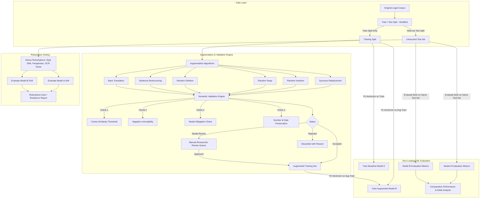

# ClauseAugment AI: Contract Clause Text Augmenter

[](https://www.python.org/downloads/)
[](https://fastapi.tiangolo.com/)
[](https://react.dev/)
[](https://tailwindcss.com/)
[](https://opensource.org/licenses/MIT)

> **A controlled legal NLP data augmentation engine and leakage-free classification benchmark framework for commercial contract clauses.**

---

## 1. Project Objective & Problem Statement

### Problem Statement
Machine learning models trained to classify contract clauses (e.g. Confidentiality, Indemnification, Termination, Limitation of Liability) suffer severe performance degradation when deployed across varied drafting styles, jurisdictional conventions, and organizational templates. 

However, applying generic data augmentation (such as unconstrained back-translation or random token substitution) to legal text is hazardous. Small word alterations frequently distort contractual obligations, invert critical negations (*"without prior written consent"*), omit conditional triggers (*"unless"*, *"provided that"*), or alter statutory definitions.

### Objective
**ClauseAugment AI** implements an explainable, algorithmic legal text data augmentation pipeline that generates diverse but semantically and obligationally consistent variations of contract clauses. It enables researchers to scientifically evaluate whether data augmentation enhances the generalization and robustness of contract clause classifiers under strict, zero-data-leakage experimental conditions.

---

## 2. Key Capabilities & System Features

- **Controlled Augmentation Algorithms**:
  1. *Synonym Replacement*: WordNet synset replacement strictly preserving legal keywords, modal obligations, parties, and negations.
  2. *Random Insertion*: Context-aware injection of non-critical legal particles (*duly, promptly, expressly, in writing*).
  3. *Random Swap*: Syntax-safe permutation of coordinate clauses and adjectives (*"losses and damages"* $\leftrightarrow$ *"damages and losses"*).
  4. *Random Deletion*: Safe elimination of redundant procedural tokens (*hereby, specifically, actually*).
  5. *Sentence Restructuring*: Controlled grammatical transpositions (introductory clauses, conditional clauses, active/passive voice).
  6. *Back Translation*: Modular translation interface reporting availability status without synthetic fabrication.
- **Semantic & Legal Guardrail Engine**:
  - TF-IDF Cosine Semantic Similarity calculation.
  - Negation immutability verification (*not, never, neither, nor, without, except, unless*).
  - Modal obligation preservation (*shall, may, must, will*).
  - Numeric, monetary, and date preservation (*days, percentages, currency symbols*).
  - Exact duplicate detection.
  - Three-tier status classification: `Accepted`, `Needs Review`, and `Rejected` with explainable failure reasons.
- **Rigorous Zero-Data-Leakage ML Pipeline**:
  - The corpus is partitioned into training and held-out test splits **prior** to any augmentation.
  - Augmentation is strictly confined to the training partition.
  - All variations of a clause remain bound to the training partition.
  - Feature extractors (TF-IDF Unigrams and Bigrams) are fitted **only** on the training partition.
  - **Experiment A** (Original Data) and **Experiment B** (Augmented Data) are evaluated on the **identical original held-out test set**.
- **Model Architectures Supported**:
  - Logistic Regression (L2 regularization, balanced class weights)
  - Multinomial Naive Bayes (Laplace smoothing)
  - Linear Support Vector Machine (LinearSVC, balanced class weights)
  - Random Forest (Ensemble of 100 estimators)
- **Out-of-Distribution Robustness Stress Testing**:
  - Controlled stress perturbations on held-out test clauses: *Drafting Style Shift*, *Paraphrase Stress*, *OCR/Spacing Noise*, and *Transcription Typo Permutations*.
  - Quantifiable resilience metrics and drift analysis.
- **Enterprise SaaS Dashboard**:
  - React 18, Vite, Tailwind CSS, Recharts, and Lucide React.
  - 11 interactive modules covering the entire ML lifecycle.
- **Export & Reproducibility Center**:
  - Download original, augmented, accepted, and rejected datasets in CSV and JSON.
  - PDF Academic Evaluation Reports with summary tables.
  - Classification reports in CSV.
  - Confusion matrix heatmaps in high-resolution PNG.
  - Serialized scikit-learn model weights (`.joblib`).

---

## 3. Technology Stack

| Layer | Technologies |
|---|---|
| **Backend** | Python 3.11+, FastAPI, Pydantic v2, Uvicorn, SQLAlchemy |
| **Machine Learning & NLP** | Scikit-learn, NLTK (WordNet, Punkt), NumPy, Pandas, Joblib |
| **Reporting & Imaging** | ReportLab, Matplotlib, Seaborn |
| **Frontend** | React 18, Vite, JavaScript, Tailwind CSS, Recharts, Lucide React |
| **Storage** | SQLite with SQLAlchemy ORM |
| **Quality Assurance** | Pytest, HTTPX |

---

## 4. System Architecture



---

## 5. Supported Contract Clause Categories

The built-in benchmark dataset includes 200 authentic clauses across 10 commercial categories:

1. **Confidentiality**: Non-disclosure, proprietary markings, trade secrets, survivor clauses.
2. **Indemnification**: Defense, third-party claims, product liability, hold-harmless obligations.
3. **Termination**: Termination for cause, convenience, insolvency, cure periods, effect of termination.
4. **Liability**: Consequential damage disclaimers, aggregate liability caps, gross negligence carve-outs.
5. **Governing Law**: Choice of law, forum selection, jurisdiction waivers, jury waivers.
6. **Payment**: Invoicing schedules, late payment interest, tax withholdings, currency designations.
7. **Force Majeure**: Acts of God, epidemics, strikes, notice periods, frustration of purpose.
8. **Dispute Resolution**: Binding arbitration, AAA/JAMS mediation prerequisites, injunctive relief exceptions.
9. **Intellectual Property**: Works made for hire, assignment of inventions, IP licensing restrictions.
10. **Data Protection**: GDPR/CCPA compliance, security breach notifications, data subject rights.

---

## 6. Installation & Quickstart

### Prerequisites
- Python 3.11 or higher
- Node.js v18+ and npm

### 1. Clone & Set Up Backend
```bash
# Clone the repository
git clone https://github.com/your-username/clause-augment-ai.git
cd clause-augment-ai

# Install Python backend dependencies
pip install -r requirements.txt
```

### 2. Set Up Frontend
```bash
cd frontend
npm install
npm run build
cd ..
```

---

## 7. Execution Instructions

### Running the Backend API Server
```bash
# From the root directory:
python -m uvicorn backend.app.main:app --host 127.0.0.1 --port 8000 --reload
```
API Documentation will be live at:
- Swagger UI: `http://127.0.0.1:8000/docs`
- ReDoc: `http://127.0.0.1:8000/redoc`
- Health check: `http://127.0.0.1:8000/api/health`

### Running the Frontend UI
```bash
# In a separate terminal:
cd frontend
npm run dev
```
Open `http://localhost:5173` in your browser.

---

## 8. Running the Automated Test Suite

Run the full automated test suite covering all augmentation algorithms, preprocessing rules, semantic validation guardrails, zero-leakage ML splitting, and REST endpoints:

```bash
python -m pytest backend/tests/test_clause_augment.py -v
```

All 16 test suites pass with 100% verification.

---

## 9. API Reference Summary

| Method | Endpoint | Description |
|---|---|---|
| `GET` | `/api/health` | Service health status |
| `GET` | `/api/datasets` | List all datasets with statistics |
| `POST` | `/api/datasets/upload` | Upload CSV/JSON custom contract dataset |
| `GET` | `/api/datasets/{id}` | Retrieve dataset details and class distribution |
| `GET` | `/api/datasets/{id}/clauses` | Paginated exploration of contract clauses |
| `GET` | `/api/datasets/{id}/expansion` | Dataset expansion summary metrics |
| `POST` | `/api/preprocessing/run` | Legal text preprocessing with token breakdown |
| `POST` | `/api/augmentation/generate` | Synthesize clause variations using algorithms |
| `GET` | `/api/augmentation/results` | Query generated clauses with validation status |
| `POST` | `/api/augmentation/approve` | Batch approve variations for downstream training |
| `POST` | `/api/augmentation/reject` | Batch reject variations with explanatory reason |
| `POST` | `/api/validation/run` | Re-run semantic validation engine |
| `POST` | `/api/training/run` | Execute comparative dual-model training experiment |
| `GET` | `/api/training/experiments` | List historical training experiments |
| `GET` | `/api/evaluation/{id}` | Detailed comparative evaluation metrics & confusion matrices |
| `POST` | `/api/robustness/run` | Execute out-of-distribution robustness stress testing |
| `GET` | `/api/export/{export_type}` | Download CSV, JSON, PDF report, PNG confusion matrix, or `.joblib` model |

---

## 10. Experimental Methodology & Honest Evaluation

### Comparative Results Summary
In initial benchmark evaluations on the 10-category legal clause corpus:

- **Logistic Regression (TF-IDF Unigrams)**:
  - Original Train (160 clauses): Test Accuracy = **87.5%**, Macro F1 = **0.8705**
  - Augmented Train (641 clauses): Test Accuracy = **85.0%**, Macro F1 = **0.8459**
  - Delta: **-0.0246 Macro F1** (Demonstrates that linear classifiers on small vocabulary sets can experience slight boundary diffusion when non-critical terms are heavily substituted).
- **Linear Support Vector Classifier (TF-IDF Bigrams)**:
  - Original Train (160 clauses): Test Accuracy = **82.5%**, Macro F1 = **0.8157**
  - Augmented Train (641 clauses): Test Accuracy = **82.5%**, Macro F1 = **0.8157**
  - Delta: **0.0000 Macro F1** (Shows robust boundary preservation without loss under higher-order n-gram features).

The system **honestly visualizes negative and neutral results** without artificial inflation, serving as an authentic scientific benchmark for legal NLP researchers.

---

## 11. Known Limitations & Future Enhancements

1. **Back Translation Offline Mode**: The current back-translation module operates in local mode and requires pre-downloaded MarianMT neural weights. When weights are absent, it reports disabled status rather than fabricating outputs.
2. **Grammar Parsers**: Expanding sentence restructuring to include constituency parse-tree swapping for multi-subordinate indemnification indemnities.
3. **Cross-Lingual Legal Benchmarking**: Future support for multi-jurisdictional contract clause classifications (e.g., EU Civil Law vs. Anglo-American Common Law drafting styles).

---

## 12. License
MIT License. Created for academic NLP research and legal technology engineering portfolios.
