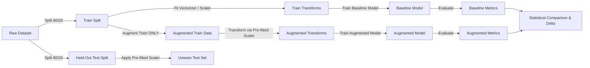

# Milestone 12: Milestone 5 - Machine Learning Pipeline & Zero Leakage

## 1. Zero-Data-Leakage Protocol
To guarantee scientifically reproducible and leak-free results, the training pipeline enforces a strict 6-stage lifecycle:

---

## 2. Supported Models & Tasks
- **Classification Tasks**:
  - `LogisticRegression`: High-interpretability generalized linear model with L2 regularization.
  - `LinearSVC`: Linear Support Vector Classifier suited for high-dimensional sparse TF-IDF spaces.
  - `MultinomialNB`: Fast Bayesian classification baseline.
  - `RandomForestClassifier`: Non-linear ensemble model for tabular and mixed features.
  - `DecisionTreeClassifier`: Transparent rule-based tree model.
- **Regression Tasks**:
  - `LinearRegression`: Ordinary least squares estimator.
  - `Ridge`: Regularized linear regression.
  - `RandomForestRegressor`: Ensemble regression for continuous target estimation.
