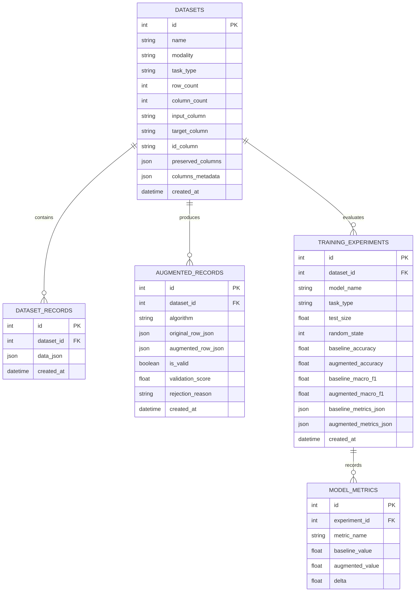

# Milestone 16: Database Schema & ER Diagram

## 1. Entity-Relationship Overview
The SQLite database stores raw datasets, column definitions, individual records, augmented samples, validation outcomes, and training experiment benchmarks.

